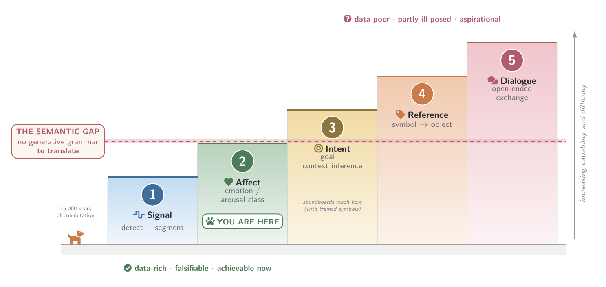

<div align="center">

# 🐾 Woof-to-Word

### The Canine Rosetta Stone
**How Far Are We from Translating What Dogs Say?**

*A survey of cross-species communication decoding in the age of foundation models.*

[](paper/main.pdf)
[](paper/sections/12_bibliography.tex)
[](LICENSE)
[](https://mcxiaoxiao.github.io/woof2word/)
[](#contributing--参与)

**English** · [中文](#中文)

</div>

---

## The question · 问题

> Can a machine turn a bark into a sentence? Consumer apps already claim
> ">80% accuracy." Landmark projects decode whales, dolphins, and finches.
> So — **how far are we, really, from translating what a dog says?**

This repo holds an open, evidence-bounded **survey** that refuses to answer
with a single number. Instead it gives you a **ruler**.

## The translation ladder · 翻译阶梯

"Translating a dog" is not one capability but five. Our central finding:
**today's systems live on Rung 2, with a foothold on Rung 3.** Everything
above is aspirational or — in the strong sense — *ill-posed*.

| Rung | Capability | Status |
|:---:|---|---|
| 1 | **Signal** — detection & segmentation | ✅ solved |
| 2 | **Affect** — emotion / arousal class | ✅ shipping (this is what "translators" really do) |
| 3 | **Intent** — goal + context inference | 🌱 emerging (soundboards) |
| 4 | **Reference** — symbol → object | ❓ unproven |
| 5 | **Dialogue** — open-ended exchange | ❓ possibly ill-posed |

The dashed line between Rung 2 and 3 is the **semantic gap**: a dog's natural
signal has no recursive, generative grammar to translate. More compute won't
fix a category error.

<p align="center">
  
</p>

## What's inside · 内容

```
woof-to-word/
├── paper/
│   ├── main.tex            # the survey (LaTeX, TikZ figures)
│   ├── main.pdf            # compiled, 29 pages, 222 cited references
│   ├── sections/           # 11 sections + bibliography (11 comparison tables)
│   └── figures/            # 3 TikZ figures (PNG previews)
├── docs/
│   └── index.html          # the cute project page (GitHub Pages)
├── sources/
│   └── search-log.md       # documented searches & dates
├── README.md
├── CITATION.cff
└── LICENSE
```

## The CS/AI core · 计算机视角

The survey is written **from a computer-science and AI standpoint**, with
biology, linguistics, and ethics as supporting witnesses. Eleven comparison
tables carry the argument; the CS/AI core includes:

- **The human translation genealogy** — seq2seq → attention → Transformer →
  pretraining/LLMs → multilingual MT (NLLB) → speech/audio foundation models
  (Whisper, Seamless), and what each layer offers animal decoding.
- **The speech/audio toolkit** — self-supervised encoders (wav2vec 2.0, HuBERT,
  data2vec), neural codecs (SoundStream, EnCodec, AudioLM), and audio-LLMs,
  mapped to their transfer value.
- **A transfer-feasibility audit** — which presuppositions of human MT survive
  contact with animal signals (the acoustic layers transfer; the semantic and
  evaluative layers do not).
- **Seven lessons** from human MT for animal decoding.
- **An existence-proofs table** adjudicating feasibility (below).
- **A consolidated limitations table** auditing the evaluation crisis.

## Is it even possible? · 是否可行

We refuse to assume the destination exists. History offers three templates for
an impossible-sounding goal, and we adjudicate each rung against them:

| Template | Meaning | Verdict for dog "translation" |
|---|---|---|
| **Alchemy** | a category error; no effort reaches it | Rung 5 (open-ended sentences): *possibly* this — the target may not exist |
| **Flight** | declared impossible, but sound physics; achieved once mechanisms assembled | Rungs 1–4: **this** — hard but grounded, with existence proofs already in hand |
| **Perpetual motion** | provably impossible by conservation law | **none** — no theorem forbids interspecies understanding |

The existence proofs are real: referential alarm calls (vervets, prairie dogs),
the honeybee dance, dolphin signature whistles, compositional tit calls; and on
the canine side, pointing comprehension, voice-sensitive brain regions, fMRI
reward responses, and soundboard word use. So *something* genuine is achievable.
The honest claim is layered: **affect-and-intent decoding is flight; open-ended
sentence translation of a non-linguistic signal is alchemy-like — possibly
ill-posed, not provably impossible.**

## The honest answer · 诚实的回答

- **Rungs 1–2:** essentially here. A *calibrated, validated* welfare monitor
  (stress / pain / arousal) is a **2–4 year** horizon. Useful — but not
  "translation."
- **Rung 3:** a foothold. Validated natural-signal intent ≈ **2030+**, once
  the evaluation infrastructure exists.
- **Rungs 4–5:** **no credible timeline.** There may be no language there to
  translate. The Rosetta Stone worked because one decree existed in three
  scripts; for the dog, there may be no decree — only a rich, graded,
  affective life we can learn to *read*, but not to *transcribe*.

## Build the paper · 编译

Requires [Tectonic](https://tectonic-typesetting.github.io/) (self-contained
LaTeX engine):

```bash
cd paper
tectonic main.tex      # → main.pdf
```

## Citation · 引用

```bibtex
@misc{wooftoword2026,
  title  = {The Canine Rosetta Stone: How Far Are We from Translating
            What Dogs Say? A Survey},
  author = {The Woof-to-Word Project},
  year   = {2026},
  url    = {https://github.com/mcxiaoxiao/woof2word}
}
```

## Contributing · 参与

Corrections, missing references, and **falsification attempts** are welcome
(see §10 of the paper for what would change our mind). Open an issue or PR.
Please keep claims evidence-bounded: label vendor numbers as *claims*, and
peer-reviewed results as *results*.

---

<a name="中文"></a>
## 中文

**我们距离翻译小狗说的话还有多远？而且，这件事究竟可行吗？** 本仓库是一篇
开放、证据有界的**综述**（29 页，引用 222 篇文献，含 11 张大型对照表与 3 幅图），以
**计算机 / AI 视角**为主、生物・语言・伦理为辅。核心工具是一架"翻译阶梯"：
把"翻译狗语"拆成五层能力。结论是——**今天的产品停在第 2 层（情绪分类），
少数研究摸到第 3 层（意图）**；再往上要么尚待证实，要么在严格意义上**是个
伪命题**，因为狗的自然信号里并没有可供翻译的递归生成语法。

综述系统梳理了**人类翻译的 Transformer 技术栈**（seq2seq → attention →
Transformer → 预训练 / LLM → 多语 NLLB → 语音 / 音频基础模型），并逐层审计
哪些能迁移到动物解码、哪些不能；从中提炼出**七条启示**。

**可行性裁决**（炼金术 / 飞机 / 永动机三模板）：第 1–4 层是"飞机"——难但有
坚实物理与**存在性证明**（_vervet_ 猴警报、蜜蜂舞蹈、海豚签名哨、犬类指称
理解与脑区证据），可以实现；第 5 层（开放句子翻译）更像"炼金术"——目标可能
根本不存在；而**没有任何一层是"永动机"**（没有被守恒律证明不可能）。

- 第 1–2 层（信号 / 情绪）：已经实现，**2–4 年**内可做出经过校准与验证的
  福利监测工具——有用，但不是"翻译"。
- 第 3 层（意图）：已有立足点（说话按钮研究），自然信号的意图验证约 **2030+**。
- 第 4–5 层（指称 / 对话）：**没有可信时间表**。罗塞塔石碑之所以成功，是因为
  同一份诏书有三种文字；而狗那里也许根本没有"诏书"，只有一段丰富、渐变、
  以情绪为主的生命，我们可以学着**读懂**，却无法**转写**成句子。

论文用 `tectonic main.tex` 编译；主页在 `docs/index.html`；检索记录在
`sources/search-log.md`。欢迎纠错与"证伪"。

<div align="center">

🐶 *Read the dog, don't transcribe it.* 🐾

</div>